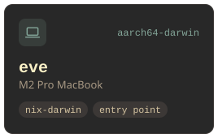
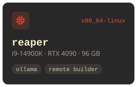
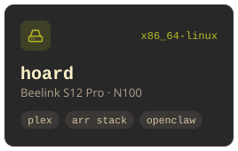
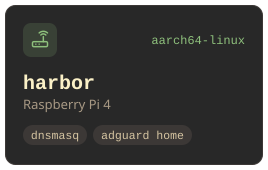
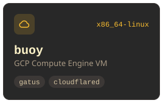
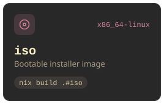

One Nix flake for every machine I run: NixOS, nix-darwin and home-manager, with secrets in sops.

[](https://github.com/gshpychka/realm/actions/workflows/check.yml)

## Fleet

<p align="center">
  <a href="machines/eve"></a>
  <a href="machines/reaper"></a>
  <a href="machines/hoard"></a>
  <br>
  <a href="machines/harbor"></a>
  <a href="machines/buoy"></a>
  <a href="machines/iso"></a>
</p>

## Layout

| Path | Contents |
| --- | --- |
| `machines/` | One directory per host |
| `modules/common/` | Typed `my.*` globals: domain, user, SSH keys, build servers |
| `modules/system/` | NixOS and nix-darwin modules |
| `modules/home-manager/` | neovim, zsh, tmux, git, coding agents |
| `overlays/` `packages/` | Package overlays and custom packages |
| `secrets/` | sops-encrypted secrets |
| `infra/` | Terraform for GCP, Cloudflare and Tailscale; the link-sanitizer Telegram bot |
| `scripts/` | Runbooks for the travel router, Kodi box and Voice PE; OpenClaw's nixos-control plugin |
| `tests/` | NixOS VM tests |

## Usage

```sh
# apply on the current machine
nh os switch
nh darwin switch

# deploy buoy
nixos-rebuild switch --flake .#buoy --target-host buoy --sudo

# build the installer and harbor's SD image
nix build .#iso
nix build .#harbor-sd-image

# evaluate every system
nix flake check --all-systems --no-build
```
